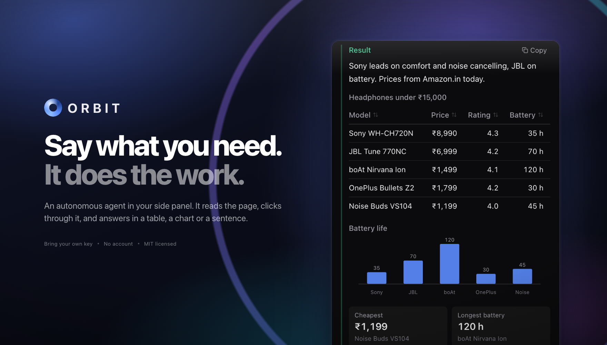
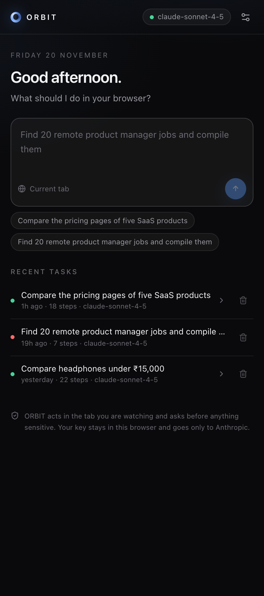
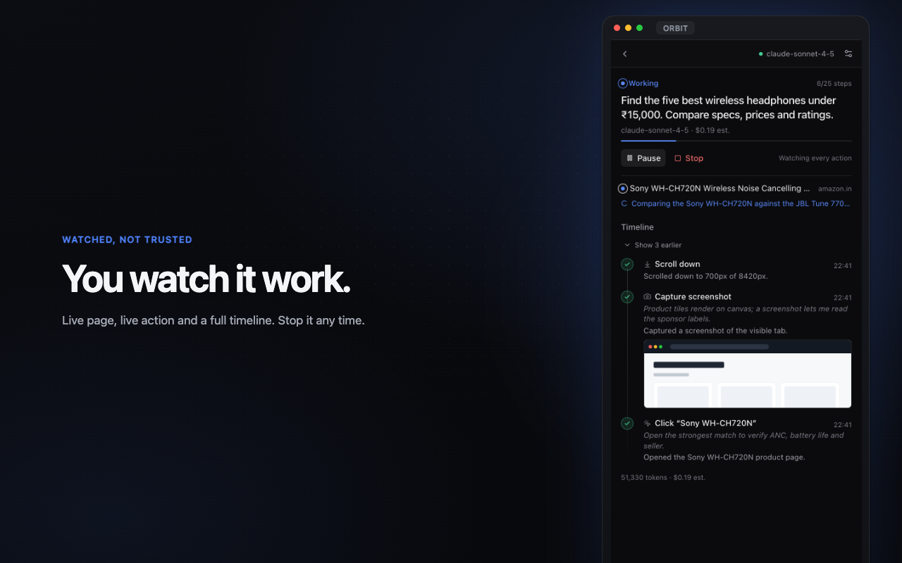
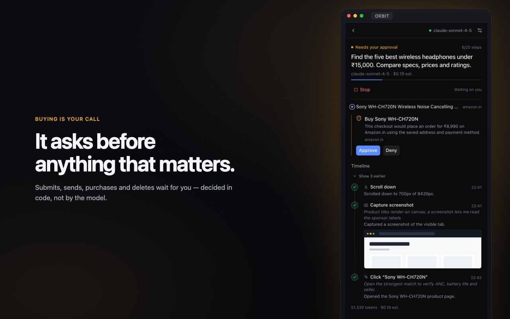
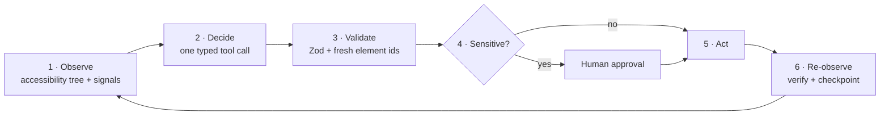

<p align="center">
  
</p>

<p align="center">
  <a href="https://github.com/srikanthamsa/orbit/releases/latest"></a>
  <a href="LICENSE"></a>
  <a href="https://github.com/srikanthamsa/orbit/actions/workflows/ci.yml"></a>
  <a href="https://github.com/srikanthamsa/orbit"></a>
  
  
  <a href="docs/development.md#testing-conventions"></a>
  <a href="CONTRIBUTING.md"></a>
  <a href="https://github.com/srikanthamsa/orbit/stargazers"></a>
</p>

<p align="center">
  <strong>Your browser. Your intelligence. Your agent.</strong><br />
  An autonomous agent, not another chat sidebar.
</p>

---

ORBIT runs beside the tab it controls. Describe an outcome in plain language and it observes the live page, chooses a typed action, verifies the result, and keeps going until the work is done. You watch every step, pause or stop at any time, and approve anything that submits, sends, buys, deletes or transfers.

**Bring your own model.** OpenAI, Anthropic, Google Gemini, DeepSeek, or any OpenAI-compatible endpoint. **No account, no ORBIT backend, no subscription.** Your key goes from your browser straight to your provider. MIT licensed.

## Why ORBIT is different

|  | **ORBIT** | Hosted browser agent | Chat sidebar |
| --- | :---: | :---: | :---: |
| Runs inside your logged-in tab | **Yes** | Remote browser | No |
| Model and API key | **Yours** | Vendor's | Vendor's |
| Page access | **Per-site, explicit** | Vendor session | Copy/paste |
| Sensitive actions | **In-loop approval** | Varies | Not applicable |
| ORBIT-operated backend | **None** | Vendor cloud | Vendor cloud |
| Source code | **MIT** | Closed | Closed |

Most browser AI stops at "here is what you could do." ORBIT does the thing — then shows you what it did.

## What it can do

- **Observation built for real pages.** A compact accessibility tree of landmarks, headings, dialogs, forms and controls, plus up to 240 interactive elements. It reaches open shadow roots, same-origin frames, offscreen controls, portals and canvas-adjacent UI.
- **Find, then act.** If the target is not obvious, the model can search the live element registry by label or role. `find` is read-only, returns stable element ids, and costs no approval.
- **Batch compatible work.** 2–5 click/type/scroll steps execute in one model turn. A batch stops at the first failure, is capped at five actions, and may contain at most one content-sensitive step in normal approval mode.
- **Human approval in code.** Submits, sends, purchases, deletions, transfers, Enter-in-a-form and new-site access pause for a decision. The decision is made by the policy module from the real target element, not by the model.
- **Honest blockers.** "Notify Me", "Sold out", CAPTCHA walls and sign-in walls end the task with that finding instead of a hunt for a button that is not there. Blind coordinate clicking is cut short when labelled controls exist.
- **Visible autonomy.** Live page, current action, full timeline, token usage, estimated cost, pause, resume and stop.
- **On-page control layer.** A page tag with Stop, a phantom cursor that names each action, and a violet inner glow that hides itself for screenshots and disappears when the run stops.
- **ORBIT tab group.** The controlled tab is colour-coded blue (working), orange (needs input), grey (paused), green (done) or red (failed). User-created groups are never hijacked.
- **Resumable by design.** State is checkpointed after every action. Close the panel and resume from Home; finished tasks keep a compact session that reopens from the recent list.
- **Any model, one protocol.** Four provider adapters and a compatible endpoint share the same typed `orbit_action` tool surface.

## Screenshots

| Ask in plain language | Watch every step | Approve what matters |
| --- | --- | --- |
|  |  |  |

## Install

ORBIT is not on the Chrome Web Store yet. Download a release, unzip it, and load the folder — no Node needed.

1. Download `orbit-<version>-chrome.zip` from [the latest release](https://github.com/srikanthamsa/orbit/releases/latest) and unzip it. Keep the folder where it is; the browser loads the extension from that path on every launch.
2. Open `chrome://extensions`, turn on **Developer mode**, choose **Load unpacked**, and select the unzipped folder.
3. Pin ORBIT from the puzzle-piece menu and click its icon — the side panel opens next to your current tab.

Edge and Brave use `edge://extensions` and `brave://extensions`. Dia runs the same build. Per-browser steps, updates, uninstall and troubleshooting are in [docs/install.md](docs/install.md).

To build it yourself with Node 20+:

```bash
git clone https://github.com/srikanthamsa/orbit.git
cd orbit
npm install
npm run zip
```

The zip and the unpacked build both land in `.output/`. Use `npm run dev` for hot reload. Requires **Chrome 116+** and **Manifest V3**. If you are updating an existing install, reload the extension, refresh the controlled tab, and reopen the side panel.

## Configure a model

1. Open ORBIT → **Settings**.
2. **Add** a provider, pick a model and paste your API key.
3. Press **Test** to verify the connection.
4. Optionally adjust step limits, spend budget and approval mode.

| Provider | Default endpoint | Notes |
| --- | --- | --- |
| OpenAI | `api.openai.com/v1` | Vision with `gpt-4o`, `gpt-4.1`, `gpt-5`, `o3/o4` |
| Anthropic | `api.anthropic.com/v1` | Direct browser access header |
| Google Gemini | `generativelanguage.googleapis.com/v1beta` | Vision built in |
| DeepSeek | `api.deepseek.com` | `deepseek-flash` (vision, 1M context) or `deepseek-v4-pro` (text-only, stronger agent) |
| Compatible | your base URL | Any OpenAI-style `/chat/completions` with tool calling |

Keys default to **session-only**: they live in `chrome.storage.session` and disappear when Chrome restarts. You can opt into persistence. Chrome extension storage is not an encrypted vault — Settings says so plainly, and ORBIT makes no encryption claims.

Cost figures are estimates from public list prices, not your provider's invoice. Unknown DeepSeek models use the DeepSeek chat price tier; other unknown models show **cost n/a**.

## How it works



1. **Observe.** The content script assigns temporary ids (`el_1`, `el_2`, …) to visible controls, records accessible names, roles, values and page text, and emits a compact accessibility tree plus explicit `PAGE SIGNALS`. Password, one-time-code and card fields are redacted. The registry lives in the extension's isolated world so ids can be verified at execution time.
2. **Decide.** The selected model receives the objective, a compact history and one structured `orbit_action` tool. It returns one action — or a bounded batch.
3. **Validate.** Every action is parsed with Zod. Arbitrary JavaScript, selectors and raw `chrome.*` access are impossible by construction. Stale element ids are rejected with guidance to observe again.
4. **Approve.** Policy classifies the real target. Sensitive controls and new origins pause the loop for a human decision.
5. **Act and verify.** Chrome APIs navigate; injected page operations click, type, scroll and press keys. A fresh snapshot verifies the result. A screenshot is never treated as proof an action worked.
6. **Checkpoint.** Task state is persisted after every action. MV3 workers are ephemeral, so the loop runs in the side-panel document and resumes from the last checkpoint if the panel closes.

### Built for pages that fight back

The DOM comes first. Screenshots and vision are a fallback when the DOM is not enough. Coordinate clicks use normalised coordinates, probe the target with `elementFromPoint`, and are checked by the same approval policy.

Page facts the model must not miss are surfaced above the element list: out of stock, CAPTCHA, sign-in wall, active dialogs, disabled primary actions and late-appended portal text. A product page that only offers "Notify Me" ends a purchase task deterministically with that explanation.

## Safety model

ORBIT drives a logged-in browser, so the threat model is credential safety, prompt injection and unintended consequential actions.

| Threat | Mitigation |
| --- | --- |
| Prompt injection from page text | Page content is labelled `(untrusted)`; actions are typed; policy decisions are made in code |
| Secret leakage | Keys stay in the side panel; never sent to content scripts, prompts, diagnostics or logs; errors are redacted |
| Unintended action | Submit, send, buy, pay, delete, remove, transfer, unsubscribe, sign up, register and book controls require approval |
| Broad page access | Per-origin grants at task start; no `<all_urls>` at install; all-sites is a separate explicit opt-in |
| Runaway agent | Step, cost and wall-clock ceilings; one corrective retry; stall detector; per-action checkpoints |
| Malicious/broken page | Fresh snapshot after every action; stale ids rejected; CAPTCHA and sign-in walls stop the run |

The model never sees keys, cookies or extension storage. It cannot emit code, choose selectors, or call `chrome.*`. An injected instruction can at most request an action the policy already classifies — and destructive actions stop for a human who sees the real label and site.

Read [docs/security.md](docs/security.md) and [SECURITY.md](SECURITY.md) for the full model, including residual risks and private vulnerability reporting.

## Privacy

- **No ORBIT backend.** Requests go from your browser directly to the provider you choose. Page observations and screenshots are part of inference — Settings and Home say so.
- **No telemetry.** No analytics, no usage pings, no remote config.
- **Local task history.** History stores summaries and action metadata, not page bodies. Screenshots are stripped from checkpoints.
- **Deletable by design.** Keys, history and checkpoints can be removed from Settings.
- **Page text is data, not instructions.** Embedded prompt injections are reported, not obeyed.

## Quality

| Layer | Command | Evidence |
| --- | --- | --- |
| Unit + orchestrator | `npm run check` | 62 tests across schema, policy, prompt, providers, tabs and the agent loop |
| Browser DOM probes | `npm run preview` → `?demo=domtest` | 27/27 checks: tree, find, shadow DOM, frames, offscreen controls, cross-realm typing, redaction |
| Built extension | `npm run smoke` | Loads the production bundle in headless Chrome, checks the panel and storage |
| End-to-end | `npm run e2e` | Real extension + real page + mocked model: find → batch → finish, page mutation, tab group, no key in prompts |

The E2E run asserts the page actually changed, the timeline shows two steps, the ORBIT tab group is green, the control layer attaches and cleans up, and the API key never appears in any model request.

## Development

```bash
npm run dev        # WXT dev build with HMR
npm run check      # TypeScript + Vitest
npm run build      # production bundle in .output/chrome-mv3
npm run preview    # real side panel at http://localhost:5199
npm run smoke      # headless extension boot test
npm run e2e        # full loop against a local page
```

```
src/
├── entrypoints/   background worker + side panel
├── agent/         orchestrator: loop, approvals, batching, recovery
├── browser/       tabs, snapshots, injected actions, screenshots, control layer
├── providers/     OpenAI / Anthropic / Gemini / DeepSeek adapters, prompts, pricing
├── safety/        approval policy, redaction
├── storage/       settings, credentials, history, checkpoints
├── components/    side-panel UI
├── screens/       Home, Workspace, Settings
└── types/         typed action protocol and data models
tests/             unit + orchestrator tests
preview/           panel harness and DOM self-test
scripts/           smoke test, E2E, screenshot capture
```

The preview harness renders the real panel against seeded state and runs the page-automation function through `Function#toString` — the exact serialization path Chrome uses. See [docs/development.md](docs/development.md), [docs/architecture.md](docs/architecture.md) and [docs/providers.md](docs/providers.md).

## Known limitations

- **One tab per task.** Multi-tab and background workflows are Phase 2.
- **No CAPTCHA bypass, ever.** ORBIT stops and asks for a human.
- **Some sites cannot be automated reliably:** canvas-only apps, aggressive bot protection and `chrome://` pages.
- **Closed shadow DOM is not traversed.** Open shadow roots and same-origin frames are.
- **Screenshots need the optional all-sites grant** (Chrome's own rule for `captureVisibleTab`). Per-site access alone supports DOM actions. Text-only models never take screenshots.
- **Costs are estimates.** They come from public list prices, not your provider's invoice.
- **A model can still make mistakes.** Approval is the last line of defence; review the action label and site before approving.

## Roadmap

| Phase | Focus |
| --- | --- |
| **1 — Core agent** (v0.3.0) | BYOK, DOM control, approvals, live timeline, visual fallback, checkpoints, accessibility tree, find, batching, tab groups |
| **2 — Advanced agent** | Multi-tab workflows, richer visual interaction, semantic recovery, task scheduling |
| **3 — Autonomous workspace** | Reusable skills, user-defined workflows, persistent preferences, background tasks |

## FAQ

<details>
<summary><strong>Does my browsing data go to ORBIT?</strong></summary>
<p>No. There is no ORBIT-operated endpoint in the code path. The extension sends page observations and, when enabled, screenshots directly to the model provider you configured.</p>
</details>

<details>
<summary><strong>Is it free?</strong></summary>
<p>ORBIT is MIT licensed and has no subscription. You pay your model provider directly at their API rates. The UI shows token usage and an estimated cost per task.</p>
</details>

<details>
<summary><strong>Can it buy things or submit forms?</strong></summary>
<p>It can operate those controls, but only after you approve the specific action. Approval is per-action; approving one submit never authorises the next. Do not leave a high-stakes purchase unattended.</p>
</details>

<details>
<summary><strong>Why a side panel instead of a background worker?</strong></summary>
<p>MV3 service workers are suspended aggressively. The side-panel document stays alive while open, and per-action checkpoints make the run resumable if it goes away. There is no long-running hidden orchestrator.</p>
</details>

<details>
<summary><strong>Can I use a local or self-hosted model?</strong></summary>
<p>Yes, if it exposes an OpenAI-compatible <code>/chat/completions</code> endpoint with tool calling. Add it as a <strong>Compatible</strong> provider and set the base URL.</p>
</details>

## Contributing

Contributions are welcome — especially provider adapters, page-edge cases, tests and accessibility improvements.

- Read [CONTRIBUTING.md](CONTRIBUTING.md) and the [Code of Conduct](CODE_OF_CONDUCT.md).
- Run `npm run check` before opening a PR.
- Report security issues privately via GitHub's vulnerability reporting; do not open a public issue. See [SECURITY.md](SECURITY.md).

If ORBIT is useful to you, a star helps other people find it.

<p align="center">
  <a href="https://github.com/srikanthamsa/orbit/stargazers"></a>
</p>

## License

[MIT](LICENSE) © 2026 ORBIT contributors
